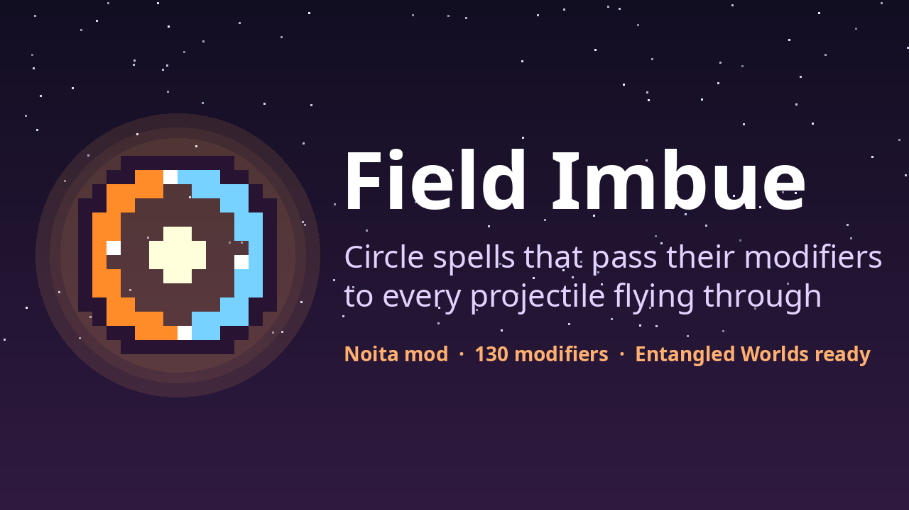

# Field Imbue

A [Noita](https://store.steampowered.com/app/881100/Noita/) mod that adds **Field resonance**, a modifier that turns circle
spells into imbuing fields. Works with [Entangled Worlds](https://github.com/IntQuant/noita_entangled_worlds) multiplayer.

## What it does

Cast **Field resonance** together with a circle spell (Circle of fervour, stillness, thunder, vigour, …) and any other
modifiers. The circle then:

- **gives those modifiers to every projectile that flies through it.** A Spark bolt fired through a *Burning trail* circle
  comes out burning; through a *Homing* circle it homes; through a *Heavy shot* circle it hits harder. Each projectile gets
  each modifier once, however many circles it crosses.
- **keeps applying their effects to enemies inside it.** Vanilla circles apply an effect once per creature; an imbuing circle
  re-applies fire, freeze, oil, poison, … every second.
- **runs their material converters over the whole circle** (*Water to poison*, *Freeze charge*'s freezing, …).
- **carries none of the modifiers' own pieces itself.** No burning or snowy centre, and it doesn't drift off with *Gravity* or
  *Fly upwards*.

Circles cast without Field resonance behave exactly like vanilla.

**130 of the vanilla modifiers work**, and modifiers added by other mods are picked up automatically when the game loads.
Excluded:

- modifiers that only change the wand (spread, recharge time, mana, recoil, Slow but steady, Heavy spread);
- modifiers whose effect depends on the moment of casting (Firecrackers, Mana to damage, Random damage, Random modifier);
- Nuke orbit and Chaos magic, unless you allow them in the settings.

### Example wands (non-shuffle, cast left to right)

| Wand | Cards |
|---|---|
| Freezing field | Field resonance → Freeze charge → Circle of fervour |
| Burning field | Field resonance → Burning trail → Circle of fervour |
| Seeker field | Field resonance → Homing → Damage plus → Circle of stillness |

Cast the field, then shoot through it with any other wand.

## Settings

Mod settings apply from the next new run.

| Setting | Default | |
|---|---|---|
| Imbue enemy projectiles | off | Circles also imbue enemy shots that fly through them. |
| Allow Nuke orbit and Chaos magic | off | Lets circles hand out nukes and random explosions to every projectile. Can cause heavy lag or crashes. |

## Multiplayer (Entangled Worlds)

Every player needs the mod (same version) and the same settings; Entangled Worlds doesn't sync other mods' settings. The
field logic is deterministic and runs on every player's copy of the field. Effects on enemies are only applied by the player
that owns the enemy, as Entangled Worlds expects.

## Sign Flip

With the [Sign Flip](https://github.com/MrWong99/noita-sign-flip) mod, a circle hands out modifiers the way Sign flip
left them in its cast:
- **Sign flip → Damage plus** heals the targets of bolts flying through the circle.
- **Sign flip → Speed up** slows those bolts to ×0.4.
- **Sign flip → Homing** makes them steer away from enemies.
- **Sign flip → Water to poison** turns poison into water over the circle.
- **Sign flip → Fire trail** puts out fire over the circle and on the bolts' paths.

Sign flip can go before or after Field resonance: `Field resonance → Sign flip → Damage plus → Circle of fervour` and
`Sign flip → Field resonance → Damage plus → Circle of fervour` both work. The same modifier can be in one circle both
flipped and plain. Each mod works without the other.

## Known limits

- *Electric charge* imbues its electric damage, but not its lightning on hit.
- Hit-effect modifiers (curses, petrify, critical on …) imbue projectiles but don't act over the circle's area.
- Field resonance has to be in the **same cast** as the circle; it doesn't reach a circle inside a trigger payload.
- Projectiles shot by other projectiles (chain-spell children, trigger payloads, sub-projectiles) are not imbued. This keeps
  spawning modifiers from cascading.

## Install

- **Steam Workshop:** subscribe to [Field Imbue](https://steamcommunity.com/sharedfiles/filedetails/?id=3825663162).
- **Manual:** download the zip from [Releases](https://github.com/MrWong99/noita-field-imbue/releases) and extract it into
  `Noita/mods/`, so that you get `Noita/mods/field_imbue/mod.xml`. Then enable *Field Imbue* in the in-game Mods menu.

## How it works

- `files/scripts/recipes_build.lua`: when the game loads, every modifier is evaluated once, the way vanilla builds spell
  tooltips. The result is a "recipe": what the modifier adds to a projectile (damage, effects, extra entities, trails, …).
- `files/gun_append.lua` (appended to `gun.lua`): records which modifiers are cast together with Field resonance and a circle,
  and keeps their own pieces off the circle.
- `files/scripts/field_*.lua` and `fi_lib.lua`: the circle's scripts. They apply the recipes to crossing projectiles,
  re-apply the effects over the area, and handle the converters.

The design notes, research and test results are in [docs/RESEARCH.md](docs/RESEARCH.md). The per-modifier analysis is in
[docs/modifier-catalog.md](docs/modifier-catalog.md).

## Development

- **`probe/`:** a separate dev-only mod (`field_imbue_probe`) that drives the game automatically. It casts wands, fires them
  and logs results to `Noita/logger.txt`. Don't enable it in normal play.
- **`tools/probe-run.sh [research|prototype|sweep [IDS] [settings]]`:** runs the probe in an isolated Proton prefix on Linux.
  `sweep` checks every modifier.
- **`tools/ew-2p.sh`:** experimental two-player Entangled Worlds harness on one machine.
- **`tools/unwak.py`:** unpacks `data.wak`.

## License

[MIT](LICENSE)
